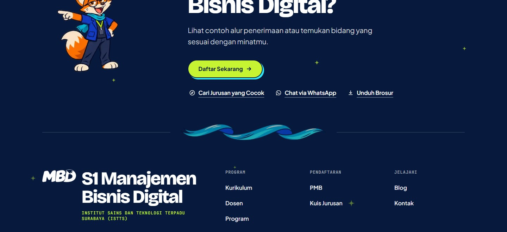

# Serah terima website S1 Manajemen Bisnis Digital

27 November 2026

`feat/vps-migration` berisi aplikasi Next.js dan Payload dalam satu proyek, migrasi PostgreSQL, konfigurasi VPS, serta aset identitas Jejak Siasat. Sumber Figma Make dan database CMS-nya berada di lingkungan terpisah.

## Screenshot

Screenshot diambil dari pratinjau lokal dengan database QA terpisah. Gambar desktop memakai lebar 1440 piksel, gambar ponsel memakai lebar 390 piksel. Foto dan nama resmi dosen masih perlu dilengkapi oleh program studi. Angka pada dashboard berasal dari data uji.

| Tampilan | Bukti |
| --- | --- |
| Beranda dan navigasi | [Desktop](../../output/handoff-2026-11-27/beranda-desktop.jpg) · [Ponsel](../../output/handoff-2026-11-27/beranda-ponsel.jpg) |
| Ombak di bawah tombol Daftar Sekarang | [Desktop](../../output/handoff-2026-11-27/cta-footer-desktop.jpg) · [Ponsel](../../output/handoff-2026-11-27/cta-footer-ponsel.jpg) |
| Kurikulum 2024 | [Filter dan tabel mata kuliah](../../output/handoff-2026-11-27/kurikulum.jpg) |
| Dosen | [Direktori dosen](../../output/handoff-2026-11-27/direktori-dosen.jpg) |
| CMS Payload | [Dashboard admin QA](../../output/handoff-2026-11-27/cms-dashboard-qa.jpg) |



## Cakupan website

- Website responsif dengan sembilan menu utama yang dikelola lewat CMS. Urutannya Beranda, Kurikulum, Dosen, Program, Karier, Blog, PMB, Kuis Jurusan, dan Kontak.
- Kurikulum 2024 mencakup 38 mata kuliah dalam semester 1–8. Dasar kurikulum tersedia di [data referensi](../../seed/curriculum-2024.json). Pengaturan publik di CMS mengendalikan penayangan total SKS.
- Bagian Dosen di beranda terhubung ke direktori dan halaman profil. Empat profil QA mengikuti penanda `[ISI]` dari sumber Figma Make.
- Identitas Jejak Siasat mencakup logo terang dan gelap, 25 ekspresi kartun, serta tiga animasi WebP untuk sapaan, berpikir, dan berhasil. Galeri tersedia di `/siasat`.
- Beranda memakai ilustrasi kartun ringan di bawah tombol **Daftar Sekarang**. Untuk blok pendaftaran penuh di akhir halaman, latar navy menyambung langsung ke footer dengan satu pita statis. Saat dekorasi ombak dimatikan dari Branding, pita hilang dan garis pemisah tetap terlihat.
- Tabel yang memakai komponen DataTable menyediakan pengurutan, penyaringan, dan pembagian halaman. Koleksi Payload juga menggunakan daftar dengan kontrol pencarian dan filter yang tersedia pada masing-masing koleksi.
- Admin dapat menyusun blog dengan editor Lexical, memilih keluarga dan ukuran font dari opsi yang disediakan, mengubah warna teks, menyisipkan gambar lewat Media, menyimpan draf, dan menerbitkan artikel.
- Alur yang tersedia mencakup pendaftaran PMB, pengecekan status, dokumen PMB privat, unduhan brosur, kuis jurusan, kontak, dan pengelolaan konten di CMS.

## Pengoperasian CMS

1. Masuk melalui `/admin` pada lingkungan yang akan diedit. Gunakan akun dan peran untuk lingkungan tersebut.
2. Buka **Tampilan → Menu dan CTA** untuk mengatur header dan footer. Tetapkan tujuan menu sesuai slug publik. Simpan perubahan dan periksa header di desktop serta menu di ponsel.
3. Pada koleksi **Halaman**, pastikan `beranda`, `kurikulum`, dan `dosen` terbit. Isi blok jalur kurikulum dan sorotan dosen di beranda, penjelajah kurikulum pada halaman Kurikulum, serta direktori pada halaman Dosen.
4. Isi **Versi kurikulum** dan **Mata kuliah dan silabus** berdasarkan referensi resmi. Hubungkan semua mata kuliah ke versi yang sesuai dan aktifkan versi yang ingin ditampilkan. Cocokkan jumlah mata kuliah per semester dengan [data referensi](../../seed/curriculum-2024.json).
5. Lengkapi nama, profil, dan foto resmi pada koleksi **Dosen**. Aktifkan opsi tampil di beranda untuk dosen yang ingin ditampilkan di bagian sorotan. Unggah foto ke **Media** lalu pilih aset itu pada profil.
6. Buat artikel di **Blog**. Isi judul, slug, ringkasan, dan isi, lalu gunakan toolbar untuk mengatur tipografi atau menyisipkan gambar. Periksa draf di pratinjau sebelum publikasi. Buka ulang `/blog` dan alamat artikel setelah publikasi.
7. Kelola logo dan pengaturan dekorasi melalui **Branding**. Gunakan versi terang untuk latar navy. Setelah mengganti logo, periksa header, footer, dan menu ponsel.
8. Sebelum meluncurkan situs, ganti seluruh penanda `[ISI]` dengan data resmi yang tersedia. Dashboard menyediakan pelacak untuk membantu peninjauan.

## Data dan aset yang dibawa ke VPS

Git menyimpan kode, aset publik, konfigurasi, migrasi, referensi kurikulum, berkas awal peran, dokumentasi, dan screenshot. Rujukan gambar situs berada di [public/images](../../public/images). Variasi logo, galeri, dan ekspor aset tersedia di [output](../../output).

Pratinjau `localhost:3000` saat serah terima berjalan dalam mode pengembangan dan terhubung ke PostgreSQL QA yang terpisah. Akun uji, rahasia, database lokal, dan berkas privat dikelola di lingkungannya sendiri. Konten resmi dan upload dari Figma Make memerlukan ekspor terotorisasi serta impor ke Payload target. Petakan relasi memakai kunci stabil seperti slug atau nama versi, karena ID dapat berbeda antarlingkungan. Rincian mekanisme dan inventaris tersedia di [dokumen migrasi](../migration/compatibility.md) dan [daftar data sumber](../migration/source-inventory.md).

## Pengujian

| Pemeriksaan | Hasil |
| --- | --- |
| TypeScript | Lulus |
| Tes otomatis | 123 tes lulus di 29 berkas |
| Uji HTTP website dan CMS | 60 pemeriksaan lulus di `localhost:3000`, termasuk halaman publik, Media, validasi input, dan penolakan akses anonim |
| Navigasi dan akademik | Sembilan menu teruji di desktop dan ponsel, semua semester berisi mata kuliah, dan empat profil tampil di direktori QA |
| Pemisah pendaftaran | Chrome pada lebar 320–1440 piksel, termasuk mode gerakan dikurangi. Tidak ada sela antarbagian, gulir horizontal, atau animasi tambahan pada ilustrasi |
| CMS QA | Login dan dashboard berhasil. Skenario draf dan terbit, upload Media, peran, kuis, kontak, brosur, dan PMB dicatat di [hasil pengujian CMS](cms-verification.md) |

Jalankan uji ulang dari root repo saat aplikasi dan database lokal sudah siap.

```sh
mise exec -- pnpm test
mise exec -- pnpm exec tsc --noEmit
mise exec -- node scripts/smoke-cms.mjs http://localhost:3000 --require-content --require-media
```

Mode ketat membutuhkan halaman publik terbit dan logo yang terhubung ke Media. Gunakan perintah dasar tanpa kedua flag saat memeriksa instalasi baru yang belum memiliki konten.

## Checklist rilis VPS

1. Siapkan origin HTTPS, PostgreSQL, secret baru, dan penyimpanan persisten untuk Media serta dokumen PMB. Gunakan [panduan deployment VPS](deployment-preparation.md).
2. Cadangkan target sebelum migrasi atau impor. Terapkan migrasi pada PostgreSQL target sesuai urutan panduan.
3. Impor konten resmi dan Media dengan akses yang disetujui. Cocokkan slug, hubungan antarrekaman, status terbit, tautan publik, dan izin dokumen privat.
4. Build image untuk origin final setelah konten yang diperlukan tersedia. Jalankan pemeriksaan kesiapan dan uji mode ketat pada origin target.
5. Uji login, hak akses, publikasi artikel, penggantian media, PMB, kuis, SMTP atau Turnstile yang dipakai, serta pemulihan backup sebelum mengarahkan domain publik.

Verifikasi produksi VPS masih terbuka. Bukti pemeriksaan pada dokumen ini berasal dari lingkungan lokal. Perintah `figma make verify-deploy` juga belum dapat dijalankan karena CLI Figma Make tidak tersedia di lingkungan lokal.
